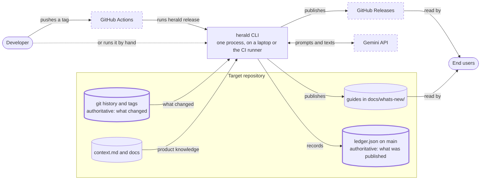
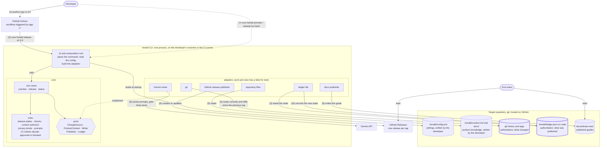

# Herald — Architecture

> Herald announces your releases and explains them to your users.

This document describes the architecture agreed so far. It is the starting point for implementation. Sections marked **Open decision** must be settled before or while the related code is written.

---

## Architecture view

Status: **proposed** — nothing is built yet. Both views cover increments 1–3 (§13).

### Overview



### Detailed view

The `herald` box opened up: the core, its ports and the adapters that connect them to the outside.



**How to read it**
- **Dashed border:** external system, outside Herald's control.
- **Thick border:** authoritative data, the source of truth when copies disagree.
- **Numbers:** the order of one automatic `herald release` run. `herald preview` does steps 4–7 and prints the texts instead of publishing them.
- **Dependency rule:** `cli` calls the core; adapters implement the ports the core defines. The core depends on neither.

**Important contracts** (assumptions one part makes about another)
- **Ports:** defined by the core; adapters must fit them, not the other way round.
- **Workflow → herald:** tags matching `v*` start a run; the workflow passes `GITHUB_TOKEN` (permission to write repository contents) and `HERALD_LLM_API_KEY`. Pushes made with `GITHUB_TOKEN` do not start new workflow runs.
- **`config.yml` and `ledger.json`:** file formats Herald relies on; the ledger carries a `version` field so its format can evolve.
- **GitHub Releases:** one release per tag, so publishing again updates it instead of duplicating it. This is what makes re-runs safe (§10).
- **Gemini API:** prompts in, text out, within free-tier limits and terms.

**Open in this view**
- Step 3: which copy of the ledger a CI run reads (§15, question 6).
- Steps 9–10: one commit or two (§15, question 8).
- Not shown: chat channels and manual approval, the next architectural change (§13, increments 4–5).

## 1. Purpose

When a release is tagged, Herald automatically:

1. collects what changed since the previous release;
2. writes three texts with an LLM:
   - a **changelog** for developers (short, technical);
   - a **"What's new" guide** for end users: what is new, how to use it step by step, and how it fits with what users already know (linking existing documentation when available);
   - a **short message** announcing the release;
3. publishes them to the configured channels;
4. records what was published, so nothing is published twice.

## 2. Requirements

### Functional
- **Automatic:** runs on its own when a release tag is pushed.
- **Manual:** the same operations can be run by hand from the terminal.
- **Preview:** everything except publishing, printed to the terminal.
- **Approval policy:** `auto` today; `manual` must be addable later without changing the core.

### Constraints and quality attributes
- **Same code locally and in CI.** No logic in workflow files.
- **No server.** Herald is a CLI; GitHub Actions only invokes it.
- **Invariant:** a release is published **at most once per channel**.
- **Automatic approval only passes deterministic checks** (see §6.4).
- **Replaceable integrations:** changing the LLM provider or adding a channel touches one adapter only.
- **Privacy control:** the user decides how much code is sent to the LLM.
- **Zero cost:** free tiers only.
- **Minimum input:** git history plus a context file. Documentation and user-visible files improve results but are optional.

### Non-goals (for now)
- Reading or understanding the whole codebase.
- A hosted service / multi-tenant SaaS.
- Non-technical users configuring the tool.
- Chat channels (Telegram, Slack) — they arrive together with manual approval.
- Wiki sources.

## 3. Architectural style

- **Hexagonal architecture (ports and adapters)** inside a **single program**: the `herald` CLI.
- **The core** (domain, use cases, rules) depends on nothing external. It talks to the outside world only through **ports** (interfaces it defines).
- **Adapters** implement ports with concrete technologies. Every port has a **fake adapter** for tests.
- **Publishers are a plugin-like extension point:** several channels are active at the same time, each in its own adapter.
- **Stateless process, persistent state outside.** The program keeps nothing between runs. Every command: (1) loads the current state from the ledger, (2) checks the action is allowed, (3) runs its steps, (4) writes the new state.
- **Configuration is read only at startup** by the composition root, which builds the adapters and hands them to the core. The core never reads configuration files.

**Dependency rule:** `cli → core ← adapters`. The core never imports from `adapters/` or `cli/`.

## 4. Runtime and triggers

Herald runs in two places, with the same code:

| Where | Who starts it | Typical command |
|---|---|---|
| Developer machine | The developer | `herald preview v1.3.0`, `herald release v1.3.0` |
| GitHub Actions runner | A pushed tag `v*` | `herald release ${{ github.ref_name }}` |

Because a run may happen on either machine, **state must live where both can reach it**: in the repository (ledger file) and on GitHub (releases).

### Workflow (reference)

```yaml
name: herald
on:
  push:
    tags: ['v*']

permissions:
  contents: write          # create releases, commit docs and ledger

concurrency:
  group: herald            # serialize all Herald runs in the repository
  cancel-in-progress: false

jobs:
  release:
    runs-on: ubuntu-latest
    steps:
      - uses: actions/checkout@v4
        with:
          fetch-depth: 0   # full history and tags; required for git log/diff between tags
      # install herald (method depends on the implementation language)
      - run: herald release ${{ github.ref_name }}
        env:
          GITHUB_TOKEN: ${{ secrets.GITHUB_TOKEN }}
          HERALD_LLM_API_KEY: ${{ secrets.HERALD_LLM_API_KEY }}
```

Notes:
- The tag checkout is a detached HEAD. Commits (guide, ledger) go to the **default branch**, fetched explicitly, never to the tag.
- Pushes made with `GITHUB_TOKEN` do not trigger new workflow runs, so committing the ledger does not loop.

## 5. Commands

| Command | What it does |
|---|---|
| `herald init` | Creates `.herald/config.yml`, a first draft of `.herald/context.md` (from README and code, to be corrected by the user) and the workflow file |
| `herald preview <tag>` | Collects changes, builds context, writes the three texts, runs the checks, **prints the result**. Publishes nothing, writes no state. With no tag: from the latest tag to `HEAD` |
| `herald release <tag>` | Full run: prepare → approve (by policy) → publish → record |
| `herald status [<tag>]` | Shows the state of a release and of each channel from the ledger |
| `herald approve <tag>` | **Future**, only with `approval: manual` |

Every command shows its progress step by step in the terminal.

## 6. Core

### 6.1 Domain model

| Entity | Content |
|---|---|
| `Release` | tag, previous tag, state, timestamps |
| `ChangeSet` | commits (message, author, date), changed files (path, status, size), optional diff excerpts |
| `ProductKnowledge` | product description, audience, glossary, feature areas, relevant documentation pages, user-visible files (loaded through the `ProductContext` port) |
| `Draft` | `changelog`, `guide`, `message`, plus metadata (provider, model, prompt version) |
| `Delivery` | channel, state, external id, timestamp, error |

### 6.2 Use cases
`preview`, `release`, `status` (and later `approve`). Use cases are the **driving ports**: the CLI and the tests call them.

### 6.3 State

Two levels, deliberately separate:

**Run steps (in memory, discarded at the end of the command).** Example for `release`:

```
changes collected → context built → texts written → checks passed → published → recorded
```

They drive the progress display and error messages.

**Release lifecycle (persisted in the ledger).**

```
Release:   prepared ──► approved ──► published
               │
               └──► blocked      (checks failed; re-running release regenerates)

Delivery (per channel):   pending ──► publishing ──► published
                                            └──────► failed   (retryable)
```

A release is `published` when every enabled channel is `published`. Re-running `release` on a partially published release retries only the channels that are not `published`.

### 6.4 Rules
- **Invariant:** at most one published delivery per (release, channel).
- **Approval policy** (`approval` in config):
  - `auto`: the release moves to `approved` **only if all checks pass**; otherwise it goes to `blocked` and nothing is published;
  - `manual` (future): the release stops at `prepared` and waits for `herald approve`.
- **Deterministic checks on drafts:**
  - the release version appears in changelog, guide and message;
  - every link to documentation points to a file that exists in the repository;
  - each text respects the length limit of the channel it goes to (limits declared by the publisher);
  - no section is empty.
- **Context selection:** map changed files to feature areas (`config.yml`), pick the related documentation pages, prioritise user-visible files, respect the size budget.
- **Privacy levels** (`privacy` in config):
  - `minimal`: commit messages and changed file names only;
  - `standard` (default): plus diff excerpts of user-visible files and documentation pages;
  - `full`: plus diff excerpts of all changed files, filtered (no lockfiles, generated or binary files) and capped in size.
- **Prompts belong to the core.** They are domain knowledge; the LLM adapter only transports them.

## 7. Ports and adapters

| Port (driven) | Responsibility | Adapters (first increment in bold) |
|---|---|---|
| `ChangeSource` | What changed between two versions: commits, changed files, diff excerpts; previous tag detection | **git (local process)**, GitHub API (later; can include GitHub generated notes), fake |
| `ProductContext` | Context file, feature areas, documentation pages, user-visible files | **repository files**, wiki (later), fake |
| `Writer` | Generic "instructions in, text out" | **Gemini** (or another LLM), fake |
| `Publisher` (one per channel) | Publish a formatted text to one channel; declare its limits; be idempotent where possible | **GitHub release**, **docs file committed to the repository**, Telegram/Slack (later), fake |
| `Ledger` | Read and write release and delivery state | **`.herald/ledger.json` committed to the repository**, in-memory (tests) |

Future port, only with manual approval: `DraftStore` (where drafts wait between prepare and approve: GitHub draft release, local files).

## 8. Flow of `herald release v1.3.0`

1. Load config, build adapters (composition root).
2. `Ledger`: load state of `v1.3.0`. If already `published`, stop. If partially published, skip to step 8 for the missing channels.
3. `ChangeSource`: find the previous tag; collect commits, changed files and, per privacy level, diff excerpts.
4. `ProductContext`: load context file; map changed files to areas; load related documentation pages.
5. Core builds the prompts; `Writer` produces changelog, guide and message.
6. Core runs the checks → `prepared`, then the approval policy → `approved` or `blocked`.
7. If `blocked`: record it, print the failed checks, exit with an error.
8. For each enabled channel not yet `published`: mark `publishing`, call its `Publisher`, mark `published` (with external id) or `failed`.
9. `Ledger`: write the final state (one commit together with the guide file).

## 9. Files in the target repository

```
.herald/
  config.yml      # settings
  context.md      # product description written by the user (draft generated by `herald init`)
  ledger.json     # state, written only by Herald
.github/workflows/herald.yml
docs/whats-new/   # published guides (path configurable)
```

### `config.yml` (example)

```yaml
approval: auto            # auto | manual (future)
privacy: standard         # minimal | standard | full
writer:
  provider: gemini
  model: <model name>
channels:
  - github-release
  - docs
docs:
  source: docs/           # existing user documentation, optional
  output: docs/whats-new/
areas:                    # optional: map code to features and documentation
  - name: Reports
    paths: ["src/reports/**"]
    docs: docs/reports.md
userVisible:              # optional: files that show what users see
  - "src/i18n/en.json"
branch: main              # where guide and ledger are committed
```

### `ledger.json` (example)

```json
{
  "version": 1,
  "releases": {
    "v1.3.0": {
      "previousTag": "v1.2.0",
      "state": "published",
      "preparedAt": "2026-11-10T09:12:00Z",
      "approvedAt": "2026-11-10T09:12:05Z",
      "approvedBy": "auto",
      "writer": { "provider": "gemini", "model": "<model>", "promptVersion": 1 },
      "deliveries": {
        "github-release": { "state": "published", "externalId": "123456", "at": "2026-11-10T09:12:20Z" },
        "docs": { "state": "published", "externalId": "docs/whats-new/v1.3.0.md", "at": "2026-11-10T09:12:21Z" }
      }
    }
  }
}
```

## 10. Invariant and failure handling

- **Serialization:** the workflow `concurrency` group runs one Herald job at a time per repository.
- **Ledger check:** a channel already `published` is never published again.
- **Optimistic concurrency via git:** the ledger commit is pushed to the default branch; if the push is rejected because the branch moved, fetch, re-apply, retry (bounded attempts). A conflicting state for the same release aborts the run.
- **Exactly-once is not possible with external services.** If a run crashes after a channel accepted the text but before the ledger was written, a re-run could publish again. Strategy:
  - first-increment channels are **idempotent**: the GitHub release adapter checks whether the release for the tag already exists and updates it; the docs adapter writes a file at a fixed path. Re-running is therefore safe (at-least-once + idempotent = effectively once);
  - non-idempotent channels (chat, email) will need **at-most-once**: record `publishing` in the ledger before sending, and treat `publishing` found at start as "possibly sent, needs a human". This arrives with manual approval.

## 11. Configuration and secrets

- Secrets only in environment variables: `GITHUB_TOKEN`, `HERALD_LLM_API_KEY` (later: channel tokens).
- Locally: environment or a `.env` file excluded by `.gitignore`; for GitHub, `gh auth token` can supply the token.
- In CI: GitHub repository secrets; `GITHUB_TOKEN` is provided automatically.
- At startup, missing variables produce a clear error naming the variable. Secrets are never logged.

## 12. Testing strategy

- **Core with fakes only:** every use case is tested with fake adapters, no network, no git.
- **Invariant tests:** two concurrent `release` runs on the same tag produce one delivery per channel; a re-run after a partial failure retries only the missing channels; a crash between publish and ledger write does not duplicate an idempotent channel.
- **Check tests:** wrong version, broken link, over-length text, empty section each lead to `blocked`.
- **Adapter tests:** git adapter against a temporary repository with tags; GitHub and LLM adapters behind contract tests that can run against fakes and, optionally, real services.
- **Checks:** a pre-push git hook (`.githooks/pre-push`) runs lint, type check and build before every push, and the tests too when pushing `main`; a failure cancels the push. Releases of Herald itself only from `main`.

## 13. Increments

1. **Preview, local only:** `herald preview` with git `ChangeSource`, repository `ProductContext`, real and fake `Writer`, checks, output to terminal. No state.
2. **Release, local:** `herald release` with `Ledger` (ledger file), GitHub release and docs publishers, auto approval, invariant tests.
3. **Automatic:** the GitHub workflow calling the CLI; `herald init`.
4. **Manual approval:** `approval: manual`, `herald approve`, `DraftStore`.
5. **More channels and sources:** Telegram/Slack with at-most-once; wiki documentation source; GitHub API change source.

## 14. Suggested layout

```
src/
  core/
    domain/        # entities and value objects
    usecases/      # preview, release, status
    rules/         # state machines, checks, context selection, privacy
    prompts/       # prompt templates (versioned)
    ports/         # interfaces: ChangeSource, ProductContext, Writer, Publisher, Ledger
  adapters/
    changes/git/
    context/files/
    writer/gemini/
    writer/fake/
    publishers/github-release/
    publishers/docs/
    ledger/git-file/
    ledger/memory/
  cli/             # command parsing, progress output
  config/          # config loading, validation, composition root
tests/
```

## 15. Open decisions

These are decided during development, when working code gives evidence, not in advance.

1. ~~**Implementation language**~~ — decided: **TypeScript** (Node).
2. **One LLM call or three:** a single call returning changelog, guide and message as structured output, or one call per text.
3. **Previous tag detection rules:** semantic version ordering vs. git ancestry; behaviour for the very first release (no previous tag).
4. **How the user is notified** after an automatic release (GitHub notification only, or a message).
5. **Multiple pending releases:** behaviour when several tags arrive close together. By default GitHub keeps only one waiting run per concurrency group and cancels it when a newer one arrives (`queue: max` changes this); ordering is not guaranteed.
6. **Where the ledger is read from:** the tag checkout contains the ledger as it was at the tag, without records written after it. A re-run of the same release must not rely on that copy.
7. **Retrying a partially published release:** drafts are not stored (§7: `DraftStore` only with manual approval), so a retry needs new texts or a place to keep them.
8. **Guide and ledger in one commit or two:** one commit requires the docs publisher and the ledger to cooperate, which the ports do not provide yet.
9. **When `publishing` is persisted:** the ledger is written at the end of a run, so `publishing` (§6.3) is never saved; it becomes necessary with non-idempotent channels (§10).
10. **Where the short message is published:** the first channels are the GitHub release and the docs file; neither is assigned the message yet (increment 2).

## 16. Implementation guidelines

- Start from the core: domain, state machines and checks, tested with fakes, before any real adapter.
- Respect the dependency rule; keep adapters thin.
- No business logic in workflow YAML: it only installs and calls `herald`.
- All names, commands, messages and documentation in English.
- Every architectural decision that changes this document gets a short ADR in `docs/adr/`.
